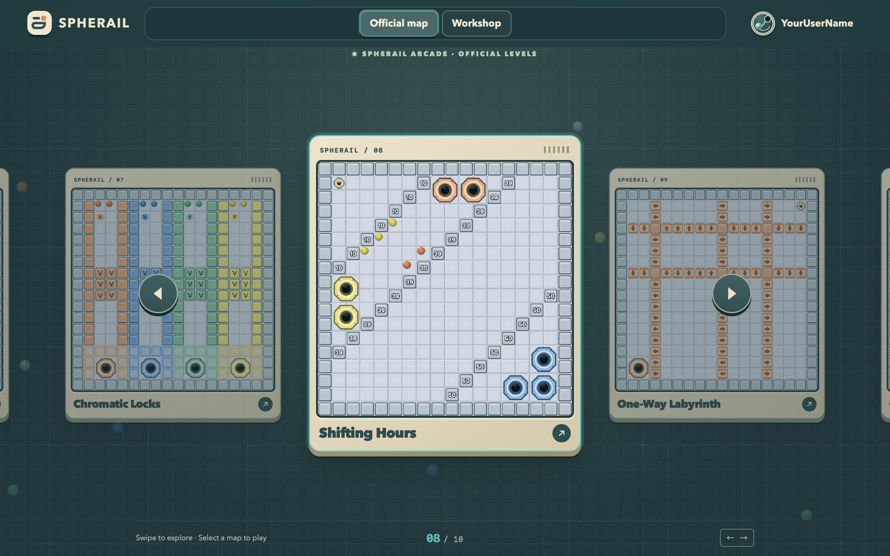

# Spherail for Mac / 绘轨

[简体中文](README.md) | **English**

[License: GPL-3.0-only](LICENSE)

Spherail is a standalone macOS game where you draw lines to guide balls into matching holes. It reads only bundled resources and data stored on your Mac. Single-player games work offline, without Django, Redis or an account. Two nearby Macs can play against each other over a local network or Bluetooth.



The lower-left corner of the player profile shows the current app version, read directly from the application bundle.

## 3D maps

Use the **3D / 2D** button in the upper-right corner of an official or custom map's difficulty screen. The 3D mode preserves the reference implementation's models, materials, lighting, camera parameters and controls. Previews transition from flat to three-dimensional; switching difficulty keeps unchanged tiles in place while animating changed models. Starting a game continues in the same scene.

Draw and erase lines in perspective, rotate and zoom the camera, lock the view, pause, restart and finish a level. Results and achievements are saved locally, and restarting from the result screen keeps the game in 3D. As in the reference implementation, duels are unavailable in 3D mode; switch to 2D to use LAN or Bluetooth multiplayer.

Three.js is pinned to the reference's `0.164.1`. Renderer code and runtime textures are bundled in the app, so playing needs no CDN or internet connection. See [THIRD_PARTY_NOTICES.md](THIRD_PARTY_NOTICES.md) for third-party licenses and texture credits.

The interface uses a deep green arcade palette. The official map browser features a looping carousel, animated backgrounds and map previews. Selecting a preview expands it into a centered difficulty selector; returning shrinks it back into its card. The map editor has a material palette on the left, the board in the center, and settings and the serve queue on the right. It supports drag and drop, erasing, undo and redo. Composite tiles are generated as local PNGs during the build and shared by the palette and board. Transitions respect the macOS Reduce Motion setting.

New maps start with an empty board enclosed by outer walls; you place the spawn points yourself. Selecting a material shows a translucent placement preview as you move over the board. Objects cannot overlap. Holes occupy 2 × 2 cells, and right-clicking any of those cells removes the entire hole. The “?” button opens a tile guide with expandable color descriptions. Each difficulty keeps its own undo and redo history.

Switching between official and custom maps uses directional fade transitions and supports rapid switching and Reduce Motion. Level achievements appear together in a fixed-height information panel without internal scrolling.

Five additional official maps bring the collection to 10 maps and 30 difficulty variants:

| Map | Chinese name | Mechanics |
| --- | --- | --- |
| Spectrum Gates | 色阶闸阵 | Color gates, one-way walls and destructible walls |
| Chromatic Locks | 四色锁廊 | Color-separated paths, key walls and hole switches |
| Shifting Hours | 时隙交织 | Timed walls that disappear in stages and holes of several colors |
| One-Way Labyrinth | 单行迷宫 | A multi-stage maze formed by one-way walls |
| Cascade Junction | 分流急湾 | Accelerators, branching paths and timed entrances |

These five maps are parsed from the unchanged authored definitions in `Assets/Levels/New_Level.md` by `scripts/extra_official_maps.py`. All 15 difficulty variants preserve their authored layouts, ball queues, serve intervals, time limits and author history, including Unicode encodings for timed walls. Hard and Master layouts are defined individually. The maps use distinct IDs, so they do not inherit records or achievements from the earlier set of five expansion maps. Existing local data is retained.

Each expansion map has one achievement on Easy, two on Hard and three on Master, for 30 achievements in total. Challenges include completing a level, finishing within a time limit, and Master challenges with a stroke limit or no incorrect captures. See `Assets/Levels/README.md` for the conditions. `scripts/verify_expansion.mjs` replays deterministic clears using the actual collision, tile and hole code. Some replays use a test-only controller to draw and erase lines; it does not change ball positions, velocities or results. All 15 variants have replays that earn every achievement. These checks establish that the challenges are achievable; manual difficulty balancing is still needed.

## Installation and use

Download the DMG for your Mac from [GitHub Releases](https://github.com/rrrome/spherail/releases/latest), open it, and drag Spherail into Applications. On a Chinese-language system, the app is displayed as “绘轨”. Local builds produce `build/Spherail-macOS.dmg`.

On first launch, Spherail creates a random `player######` name and a default avatar. Click your avatar in the upper-right corner to change your profile. You can upload a picture and drag and zoom it to crop. Custom maps and records are stored in `~/Library/Application Support/InkBall/` to preserve compatibility with earlier versions.

The Workshop lists all custom maps on your Mac, with the new-map card always first. Search by map name or sort by most or least recently edited. Click a preview to choose a difficulty and play. Cards also have edit and delete buttons; deleting a map requires confirmation. You can playtest directly from the editor.

Saving validates the map name, time limit, serve interval, and the balls, holes and supported colors for every created difficulty. Exporting from the editor or difficulty screen copies a readable `INKBALL-LEVEL/1` code for the current difficulty. Paste it into Import in the editor to use it for another difficulty in the same map.

## Multiplayer

1. Open Spherail on both Macs. Connect them to the same Wi-Fi network, or enable Bluetooth in System Settings and allow Spherail to use it. Select the multiplayer option on a difficulty screen to see nearby players running the app.
2. Choose a player to send an invitation. The invitation includes the selected map and difficulty. The recipient sees your avatar, nickname, level and difficulty, and can accept or decline.
3. After acceptance, both players enter a three-second countdown and then start the match. Both boards are shown at the same size, together with the active connection and latency. Bluetooth connections also show signal strength in dBm.
4. After finishing, a player can watch the opponent or leave. Results are shown when both players finish.

On a local network, discovery uses Bonjour and communication uses TCP. Bluetooth connections use Core Bluetooth BLE. Discoveries from both connections are merged by player ID so each player appears once. Wi-Fi discovery includes the device name, in-game nickname and avatar. Bluetooth advertisements have limited capacity, so Bluetooth-only discovery shows the nickname that fits in the advertisement.

Wi-Fi is preferred when both connections are available. If recent measurements for the same player show substantially lower Bluetooth latency, the next invitation prefers Bluetooth. Failed Wi-Fi invitations fall back to Bluetooth, and an ongoing match also attempts Bluetooth if Wi-Fi reconnection fails. Disconnections have a 20-second reconnection window.

Only the selected map difficulty is transferred. Received custom maps stay in memory for the current match and are cleared when it ends or the player leaves; they are not added to the other Mac's map library.

Your own board has a cyan border. Opponent snapshots are compressed, and a single-frame Bluetooth probe measures latency. Connections to older app versions use the previous transfer format automatically. The timer uses elapsed time, so switching windows or briefly disconnecting does not extend the level. The interface distinguishes a temporary snapshot delay from an actual disconnection.

A player who finishes can leave before the opponent. Their departure message includes their final result, allowing the opponent to continue and later settle the match using both results. Leaving before finishing counts as a forfeit.

**Device testing status:** Automated tests cover Bluetooth fragmentation, TCP framing, Bonjour discovery between two instances on one Mac, complete Wi-Fi matches on one Mac, and interface flows. Discovery, complete matches and connection switching between two physical Macs still need verification.

## Building and testing

Build requirements:

- macOS and Xcode Command Line Tools, including Swift.
- Python 3.10 or later; Python 3.12 is recommended.
- Node.js 18 or later, including npm, for the 3D bundle and JavaScript tests.
- `rsvg-convert`, installed with `brew install librsvg`.

Initialize the build environment from the project root:

```bash
bash scripts/setup.sh
```

This creates a project-local `.venv`, installs the pinned Pillow version from `requirements-build.txt`, and runs `npm ci` to install the locked JavaScript build dependencies. `npm run build:3d` bundles Three.js and the 3D renderer for local WKWebView loading. To choose a Python executable, run `PYTHON=python3.12 bash scripts/setup.sh`.

Then run:

```bash
.venv/bin/python -m unittest discover -s Tests/ResourceGeneration
npm run test:3d
node scripts/verify_expansion.mjs
swift test
bash scripts/build.sh
```

Game code, translations and UI artwork are maintained directly in `Web/`. Base map configuration and layouts are stored in `Assets/Levels/config.json` and `Assets/Levels/maps/`; expansion maps are stored in `Assets/Levels/New_Level.md`. `scripts/layouts.py` provides the local difficulty derivation rules. The resource generators use these inputs to build offline map data, editor tiles and the app icon.

`build.sh` uses the project's `.venv/bin/python` by default. Set `INKBALL_BUILD_PYTHON` to use another Python environment with the build dependencies installed. The script produces `build/Spherail.app` and `build/Spherail-macOS.dmg` and verifies the DMG checksum. The distributed app runs without Python or build tools.

The `INKBALL-MAP/1` and `INKBALL-LEVEL/1` map-code prefixes and the local network service type remain compatible with earlier versions, as do existing maps and local data. The app currently uses an ad hoc signature and has not been notarized with an Apple Developer ID. On another Mac, you may need to allow it in System Settings → Privacy & Security before opening it.

## License

Copyright (C) 2026 rrrome and contributors.

Except where otherwise stated, Spherail is free software licensed under the **GNU General Public License, version 3 only** (SPDX: `GPL-3.0-only`). You may use, modify and redistribute it under that license, including for commercial purposes. Distribution of modified versions must comply with GPLv3 requirements for license notices, change notices and complete corresponding source code. Existing third-party copyright and license notices remain in effect.

Spherail is distributed WITHOUT ANY WARRANTY, including the implied warranties of MERCHANTABILITY or FITNESS FOR A PARTICULAR PURPOSE. See [LICENSE](LICENSE) for the full terms.

Built apps include `LICENSE` and both README files in `Contents/Resources/`. When distributing an app or DMG, also provide recipients with the complete corresponding source for that exact binary version, including build scripts, for example as a source archive attached to the same release. Source repository: [rrrome/spherail](https://github.com/rrrome/spherail).
